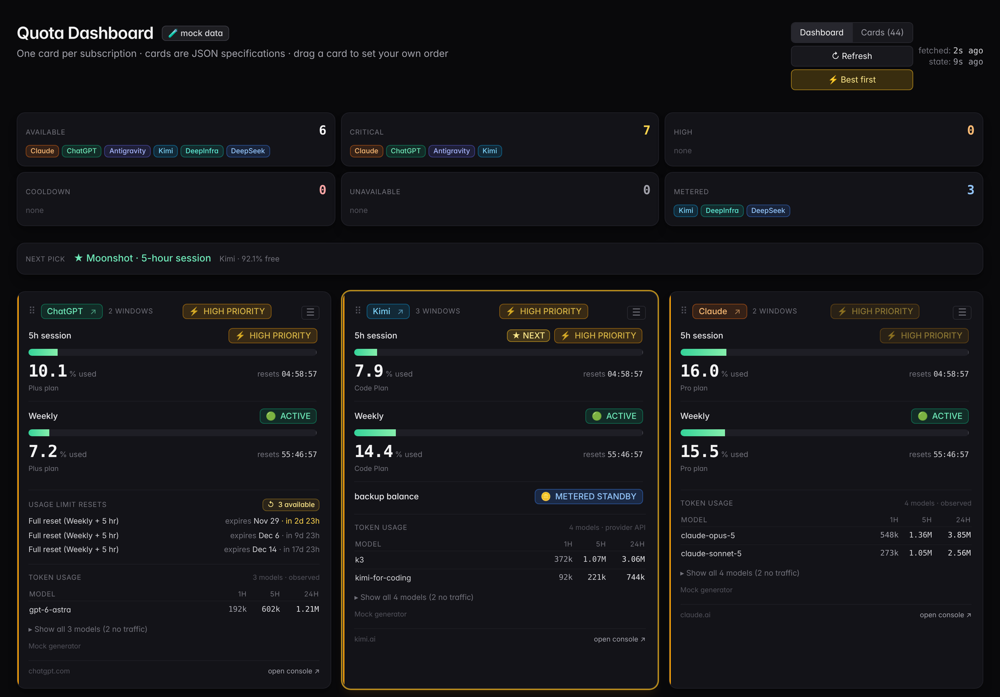
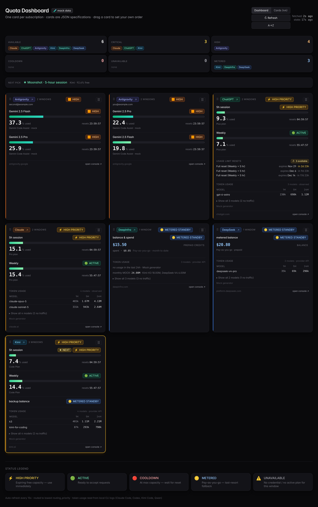

# llmquota

**One fuel gauge for every LLM subscription. You can see it, and so can your agents.**



You pay for Claude Max, ChatGPT Plus, Gemini, Kimi, MiniMax and DeepSeek. Each
one has its own limits, on its own console, resetting on its own clock. Your
agents can't see any of it. So they run straight into a 5-hour wall halfway
through a refactor. Meanwhile a weekly allowance you already paid for resets
tomorrow at 0% used, and the work spills onto pay-as-you-go credit.

llmquota reads your **real** remaining quota from every provider and puts it in
two places:

- **A live dashboard for you:** every subscription on one screen, sorted by
  what to use next.
- **An MCP tool for your agents:** before starting a task, they ask "how much do
  I have left, and where should this go?" and get a straight answer.

## The dashboard

`http://127.0.0.1:5173`. It updates itself; leave it open in a tab.

- **One card per subscription, one bar per window.** Windows show % used and a
  live countdown to reset; metered balances show dollars. Two Google accounts
  get two cards.
- **★ NEXT PICK** names the window to use right now — the one with the most
  unused capacity per hour left before it resets. **Best first** orders the
  cards by weekly capacity remaining, then metered balance, then unavailable.
- **Status panels** group providers into critical (capacity about to expire
  unused), cooldown (maxed out), metered (pay-as-you-go) and unavailable; each
  card explains why.
- **Token usage by model** over 1h / 5h / 24h, read from your local Claude Code,
  Codex, Kimi and Qwen logs, plus each provider's full model catalog.
- **Banked resets and prepaid balances.** ChatGPT usage-limit resets show with
  their expiry dates; DeepSeek, DeepInfra and Kimi show dollars.
- **One click to each provider's console**, drag-and-drop card order, and a
  **Cards** tab to switch on any of the 44 provider templates.

<details>
<summary>Full dashboard (all cards + status legend)</summary>



</details>

Screenshots use the built-in demo data (`npm run dev:mock`).

## Same data in your terminal

```
$ npm run query -- --list --text
LLM utilization — snapshot 54s old

Claude (Anthropic)  [available]
  5h session   used     7%  left    93%  resets in 4h 38m
  weekly       used     9%  left    91%  resets in 6d 1h

ChatGPT (OpenAI)  [available]
  5h session   UNAVAILABLE — not reported by provider
  weekly       used    83%  left    17%  resets in 3h 21m

Kimi (Moonshot AI)  [metered]
  5h session   used  32.5%  left  67.5%  resets in 2h 40m
  weekly       used  53.1%  left  46.9%  resets in 6d 8h
  backup balance $2.00 left
...
next: Claude 5h session — 93% left, resets in 4h 38m
```

Abridged output from a real run; percentages and countdowns move over time.

## Why agents need it

An agent with no view of its quota can't plan. It doesn't know it has 6% of a
5-hour window left, or that another provider's capacity expires unused tonight.
Give it `get_quota` and it can:

- **Avoid mid-task cutoffs.** It checks before a long job and doesn't start one
  it can't finish.
- **Route to the capacity that expires soonest.** `recommended_next` names the
  window with the most unused capacity per hour left before reset, so prepaid
  allowance gets used before it disappears.
- **Leave metered credit for last.** Prepaid balances (`dollars_left`) are
  reported separately and ranked behind subscription windows.
- **Pick the right account.** Multi-account setups such as two Google accounts
  on Antigravity show up as separate entries you can query by email.

Orchestrators that send work to several models (Codex, Claude Code, Kimi CLI,
your own scripts) get one consistent JSON shape for every provider.

## What makes it trustworthy

- **Real numbers or an explanation, never guesses.** A provider without a
  credential, or whose request fails, shows `UNAVAILABLE` and says why.
- **Local only.** Credentials stay on your machine and so does the data. The
  only network calls go from your machine to each provider's own usage endpoint.
- **Reuses logins you already have.** Claude Code, Codex, Kimi Code and Qwen are
  read from their existing credential files. Most providers need no setup.
- **Per-model token usage** comes from local CLI logs, over 1h / 5h / 24h windows.

## Install (2 minutes)

Needs Node 18.17+ and git.

```bash
git clone https://github.com/DanDuncalf/llmquota
cd llmquota
npm install
cp .env.example .env      # optional: add API keys for providers you use
npm run dev               # polling daemon + API (:8787) + dashboard (:5173)
```

Open <http://127.0.0.1:5173> to see the dashboard. Cards with a credential show
live data; the rest say what they need. To see it with demo data and no keys,
run `npm run dev:mock`. To keep it running in the background, see
[`docs/operations.md`](docs/operations.md#running-the-scraper-as-a-service)
(systemd, launchd, cron, or a Windows logon task).

**Credentials.** Log into the CLIs you already use (`claude`, `codex login`,
Kimi Code). Then set API keys in `.env` for key-based providers (MiniMax,
DeepSeek, DeepInfra). Run `npm run gemini-login -- you@example.com` once per
Google account. Every provider's details and quirks are in
[`docs/setup.md`](docs/setup.md).

> **macOS:** Claude Code keeps its token in the Keychain, not in
> `~/.claude/.credentials.json`. Set `CLAUDE_SESSION_KEY` in `.env` instead
> (see [option B](docs/setup.md#claude--needs-one-manual-step)).

## Quick start (macOS / Linux / WSL)

```bash
git clone https://github.com/DanDuncalf/llmquota
cd llmquota
npm ci
npm run dev:mock      # zero-config demo with drifting fake data
```

Then `npm run dev` for real data. Cards for any provider CLI you're logged
into on that machine — Claude Code, Codex, Kimi Code, Qwen, Gemini — fill in
automatically: credentials are discovered under `~`, nothing to configure.
API-key-only providers (MiniMax, DeepSeek, DeepInfra) want entries in `.env`
(`cp .env.example .env`). Every provider's details are in
[`docs/setup.md`](docs/setup.md); on WSL, credentials live in the Windows
home — see [`docs/setup.md` → Running under
WSL2](docs/setup.md#running-under-wsl2-or-plain-linux) for the symlink setup.

To run at login instead of in a terminal, `scripts/` ships a systemd user
unit ([`scripts/llmquota.service`](scripts/llmquota.service)) for Linux/WSL
and a launchd agent
([`scripts/com.llmquota.dashboard.plist`](scripts/com.llmquota.dashboard.plist))
for macOS — both start the scraper daemon and API server via
[`scripts/run-service.sh`](scripts/run-service.sh). See
[`docs/operations.md#running-the-scraper-as-a-service`](docs/operations.md#running-the-scraper-as-a-service).

## Connect it to your agents

The MCP server is a stdio command. Substitute the absolute path to your
checkout for `/path/to/llmquota`:

```bash
node /path/to/llmquota/node_modules/tsx/dist/cli.mjs /path/to/llmquota/src/agent/mcp-server.ts
```

**Claude Code**

```bash
claude mcp add llmquota -- node /path/to/llmquota/node_modules/tsx/dist/cli.mjs /path/to/llmquota/src/agent/mcp-server.ts
```

**Codex** (`~/.codex/config.toml`)

```toml
[mcp_servers.llmquota]
command = "node"
args = ["/path/to/llmquota/node_modules/tsx/dist/cli.mjs", "/path/to/llmquota/src/agent/mcp-server.ts"]
```

**Kimi Code** (`~/.kimi-code/mcp.json`, or `.kimi-code/mcp.json` per project)

Use the `mcpServers` block below. Run `/mcp-config` in the Kimi Code TUI to
write it interactively.

**Cursor, Claude Desktop, Windsurf, or any `mcpServers` JSON config**

```json
{
  "mcpServers": {
    "llmquota": {
      "command": "node",
      "args": [
        "/path/to/llmquota/node_modules/tsx/dist/cli.mjs",
        "/path/to/llmquota/src/agent/mcp-server.ts"
      ]
    }
  }
}
```

### Tools your agent gets

| Tool | Use it for |
|---|---|
| `get_quota(query)` | One provider, model or account: `"claude"`, `"gpt-6.1-sol"`, `"you@example.com"`. Returns `five_hour`, `weekly` (`used_pct`, `remaining_pct`, `reset_in`), `dollars_left`, per-model usage and `recommended_next`. |
| `list_quota()` | Every provider at once, when the agent is choosing where to send work. |

Answers are served from the running dashboard. If the snapshot is more than
5 minutes old, llmquota re-scrapes before answering (a few seconds). It works
with the dashboard stopped too.

### Tell the agent to use it

Registering the tool isn't enough; agents also need to be told when to call it.
Add this to your `CLAUDE.md` / `AGENTS.md`:

```markdown
Before starting any long or multi-step task, call `get_quota` for the provider
you are running on. If the 5h window has under 15% remaining, stop and report
the reset time instead of starting. When choosing among providers, call
`list_quota` and prefer `recommended_next`. Use metered (`dollars_left`)
providers only when no subscription window has capacity.
```

### No MCP? Use the CLI or HTTP

```bash
npm run query -- kimi --text          # or put llmquota.cmd on PATH (Windows)
npm run query -- --list --refresh     # JSON, fresh scrape
curl -s http://127.0.0.1:8787/        # plain-text report; last line = what to use next
```

## Providers

**Live today, six cards on by default:** Claude (Pro/Max), ChatGPT/Codex,
Gemini via Antigravity (multi-account), Kimi Code, DeepSeek, DeepInfra.
MiniMax coding plan and Qwen (catalog + usage; Alibaba has no public quota
endpoint) have scrapers too and ship hidden — switch them on in the Cards
view.

**36 further cards ship as templates** (OpenRouter, Groq, Cursor, Copilot, xAI,
Mistral, Bedrock, Vertex, Together, Fireworks…). A provider is a JSON file in
`config/cards/`. Turn one on in the Cards view; write a scraper only when you
want live numbers. See [`docs/cards.md`](docs/cards.md).

## How it works

```
scraper daemon (60s) ──► data/state.json ──► Express API :8787 ──► React UI :5173
   ├─ provider quota APIs                                        └─► llmquota CLI / MCP
   ├─ provider model catalogs
   └─ local CLI logs (token usage)
```

Each window gets a **Waste Risk Score**: `(100 − used%) / hours until reset`.
Unused capacity that is close to resetting ranks highest, and that window
becomes `recommended_next`. The rules are in
[`docs/dashboard.md#waste-risk-score`](docs/dashboard.md#waste-risk-score).

## Documentation

| Document | Contents |
|---|---|
| [`docs/setup.md`](docs/setup.md) | Credentials and quirks for every provider, `.env` tuning |
| [`docs/agent.md`](docs/agent.md) | CLI and MCP server: JSON fields, freshness, environment |
| [`docs/dashboard.md`](docs/dashboard.md) | Status panels, card windows, usage tables, Waste Risk Score, card order |
| [`docs/cards.md`](docs/cards.md) | Card JSON spec, template library, editing cards in the UI |
| [`docs/usage.md`](docs/usage.md) | Where token usage and model catalogs come from, and their caveats |
| [`docs/api.md`](docs/api.md) | HTTP API and the `curl` text report |
| [`docs/operations.md`](docs/operations.md) | npm scripts, running as a service (systemd, launchd, cron, Windows logon task), verification |
| [`docs/architecture.md`](docs/architecture.md) | Data flow, module layout, state contract, adding scrapers |
| [`AGENTS.md`](AGENTS.md) | Rules for coding agents working on this repo |

## License

MIT. Not affiliated with Anthropic, OpenAI, Google, Moonshot, MiniMax,
DeepInfra, DeepSeek or Alibaba. Most quota endpoints are internal and
undocumented, and they can change without notice. When one breaks, its card
shows `UNAVAILABLE` and the other providers keep working.
